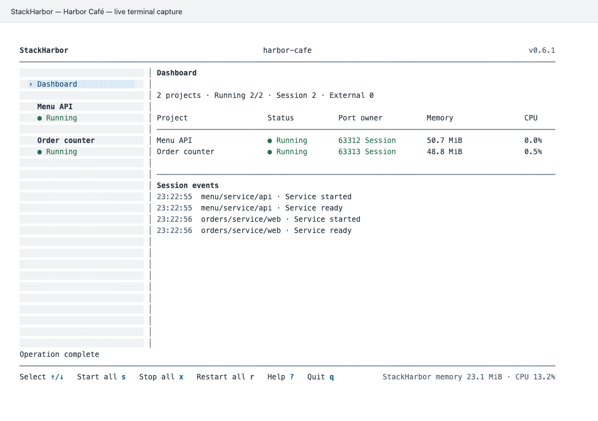
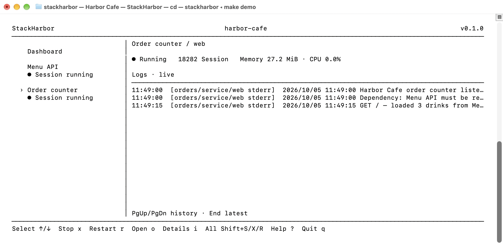

# StackHarbor · 栈港

可选的 macOS/Linux 桌面 master 使用 Tauri v2 嵌入现有 Web，支持后台驻留、全局统计
及页面控制现有项目会话。项目终端继续持有服务；退出 master 不会停止项目。
详见[桌面版安装、生命周期和构建](docs/desktop.md)。首版不支持 Windows。

**一个轻量的本地开发控制台，开发者和 Coding Agent 都可以使用。**

查看运行中的服务和端口。启动命令只需配置一次，之后可以在控制台里启动、停止或重启应用。

[English](README.md) · [发行版本](https://github.com/szhjia/stackharbor/releases) · [Agent 技能](skills/stackharbor/SKILL.md) · [参与贡献](CONTRIBUTING.md)

[](https://github.com/szhjia/stackharbor/actions/workflows/check.yml)
[](https://github.com/szhjia/stackharbor/releases/latest)
[](LICENSE)
[](https://skills.sh/szhjia/stackharbor/stackharbor)

## 开发与设计哲学

AI 编程工具让想法变成应用越来越容易。应用多了以后，启动命令、端口、日志和依赖也更难管理。StackHarbor 把这些应用集中在一个终端里，减少查命令和切换终端标签页的时间。

- **本地运行，配置可读。** 只需一个本地终端程序，无需搭建托管控制平台。
- **不改现有启动方式。** 注册应用已有的前台命令，保留各工程的语言、包管理器和启动约定。
- **显示实际运行状态。** 展示观测到的服务、监听端口、端口归属和日志。无法取得的指标显示为未知，并明确区分本会话进程与外部服务。
- **操作前说明影响。** 打开控制台不会启动服务。停止或重启依赖前，显示影响范围；释放外部端口前，核对进程身份。
- **区分不同生命周期。** 分别处理持久数据库、一次性任务和常驻服务；正常退出时清理本会话进程，保留持久资源。
- **人和 Agent 使用同一套约定。** YAML 配置有版本号，发现和校验结果可以机器读取，依赖计划只读；配套技能帮助双方检查配置，并按相同步骤接入工程。

## 核心优势

- **集中查看服务和端口。** 这里会列出已注册应用的运行状态、监听端口归属和日志位置。端口声明描述预期监听，实际端口归属和就绪状态反映当前运行情况。
- **启动命令只需配置一次。** 把工作目录、命令、端口和依赖保存在 YAML 中，之后通过控制台启动、停止或重启应用，不必再查找各自的命令。
- **在一个工作区管理多个工程。** 工具会发现并统一展示各工程的注册文件，无需改变各自的启动方式。尚未注册的候选只供检查，不会自动执行。
- **Coding Agent 可以读取同一份配置。** 配套技能帮助 Agent 按实际启动命令安装和注册应用。Agent 可以在操作前查看 JSON 格式的发现与校验结果，并用只读依赖计划检查配置。
- **本地运行，不自动接管外部服务。** 控制台运行在本机，只有显式操作才会启动服务。观察外部服务不等于获得停止权限；变更依赖前会显示影响。命令仍以当前用户权限执行。

## 与同类工具的不同

如果需要管理越来越多的本地应用，想知道哪些服务正在运行、使用哪些端口、如何启动，以及哪些进程属于当前会话，可以用 StackHarbor。它使用现有命令和工程注册文件集中展示工作区，启动、停止和重启都由用户显式触发。

| 工具 | 主要侧重 | StackHarbor 的对应侧重 |
| --- | --- | --- |
| [Process Compose](https://github.com/F1bonacc1/process-compose) | 通用本地进程编排，包含依赖、健康检查、自动恢复、终端界面、REST API 和 MCP 接口 | 工程发现、可复用注册、服务与端口状态，以及日常开发中的显式会话控制 |
| [dekit（mprocs 的下一代）](https://github.com/pvolok/dekit) | 面向开发和生产的进程管理，支持依赖、崩溃恢复、后台运行，以及供人和 Agent 使用的 CLI | 前台本地控制台；正常退出时清理会话拥有的进程并保留持久资源 |
| [Overmind](https://github.com/DarthSim/overmind) | 基于 Procfile 和 tmux 管理进程，并支持连接进程进行交互 | 使用 YAML 工程注册和工作区总览，无需依赖 tmux |
| [Tilt](https://github.com/tilt-dev/tilt) | 围绕代码变化、容器镜像构建及 Kubernetes 或 Compose 环境更新的开发循环 | 直接使用现有本地前台命令，按需接入 Compose 资源 |

StackHarbor 只需一个终端二进制，无需 tmux，只有使用 Compose 资源的应用才需要 Docker。它可以发现工程、显示服务和端口状态、复用启动命令，并标明会话归属。可以根据自己的工作方式选择工具；同类工具也支持本地运行和 Coding Agent。

## 安装

### 在 macOS 或 Linux 安装发行版

发行包支持 Apple Silicon / Intel Mac，以及 arm64 / amd64 Linux。运行二进制不需要 Go。下载并查看安装脚本后，安装最新稳定版：

```sh
curl -fsSL https://raw.githubusercontent.com/szhjia/stackharbor/main/scripts/install-release.sh -o /tmp/stackharbor-install.sh
sh /tmp/stackharbor-install.sh
export PATH="$HOME/.local/bin:$PATH"
stackharbor --version
```

安装器识别平台，使用发行版的 SHA256 清单验证下载包，默认安装到 `~/.local/bin`，不使用 sudo，也不会覆盖已有命令。需要时将 PATH 配置加入 shell 配置文件。如需指定版本和安装目录：

```sh
sh /tmp/stackharbor-install.sh 0.2.0 "$HOME/.local/bin"
```

也可以从 [Releases](https://github.com/szhjia/stackharbor/releases) 下载压缩包和 `SHA256SUMS`，校验、解压后，在解压目录执行 `sh scripts/install.sh`。升级前检查现有安装，将旧二进制备份后再安装，以便需要时恢复旧版本。发行包尚未经过 Apple 公证。

启动服务前必须能检查进程树；权限不足或缺少 `ps` 时会拒绝启动。请在执行环境中允许进程检查，Linux 需安装 `procps`。关闭期间若检查失败，StackHarbor 仍会刷新已知进程身份，并明确报告无法确认后代进程已完整清理。

交互模式需要真实终端。工具用 `ps` 观察进程树，安装 `lsof` 后可识别实际监听者；未安装时，端口归属显示为未知。Linux 打开网址需要 `xdg-open`。应用仍需自己的运行依赖；Docker 只在使用 Compose 资源时需要。

### 可选：安装 Coding Agent 技能

通过 skills CLI 安装技能（需要 Node.js/npm）：

```sh
npx skills add szhjia/stackharbor
```

公开技能页面：[skills.sh 上的 stackharbor](https://skills.sh/szhjia/stackharbor/stackharbor)。上述命令直接从本 GitHub 仓库安装技能。

安装技能本身不会安装 StackHarbor。如果源码目录或发行包解压目录会长期保留，也可以在其中执行 `sh scripts/install-skill.sh`，将完整技能链接到 `~/.agents/skills`。

## 使用

### 体验自带演示

安装 Go 1.26+、Node 26.9.0/npm、Git 和 Make 后：

```sh
git clone https://github.com/szhjia/stackharbor.git
cd stackharbor
make demo
```

这条命令会编译 StackHarbor 并打开 Harbor Café。在总览页按 **s**，核对范围并确认后，即可启动服务，默认使用 18281–18282 端口。若有端口冲突，先检查冲突进程和影响范围。按 **q** 停止本会话启动的进程并退出。

### 界面释义：以 Harbor Café 为例

[Harbor Café](examples/harbor-cafe) 是本说明配套的咖啡店示例，可以直接运行：**Menu API** 提供三款饮品，**Order counter** 从 API 读取菜单。点单服务必须等菜单 API 就绪后才能启动。运行 `make demo`，在总览页按 **s** 并确认。



总览页显示正在运行的服务、监听端口及端口归属。截图为旧版；当前 **Running 2/2** 包含就绪的外部服务，**Session 2** 单独统计本会话管理的服务。**Running ext** 表示外部端点就绪，**Listening** 只确认存在监听；**Port owner** 显示实际观测到的监听端口归属，内存和 CPU 也来自进程实测。**Session events** 记录了点单服务等待菜单 API 就绪后启动的过程。截图来自 macOS 自带 Terminal。



按 **↓** 选中 **Order counter**，查看实时日志。打开 `http://127.0.0.1:18282/` 后，点单服务会从 API 读取饮品菜单，并生成截图中的请求日志。按 **i** 查看命令和路径详情，按 **o** 打开服务页面，按 **Home** 返回总览。按 **q** 停止这两个由本会话管理的进程并退出。

软件界面使用英文，这段说明也有 [English 版本](README.md#interface-walkthrough-harbor-café)。Docker 工作区中，用上下键选择 Docker，左右键切换容器，也可以按 `d`。容器页面实时显示内存和 CPU 用量；这个咖啡店示例不需要 Docker。

### 接入自己的应用

在工作区根目录运行 `stackharbor`。工具会发现 `stackharbor.yaml`，并读取已有的 `stackharbor.workspace.yaml`。它也会列出从 manifest 中发现但尚未注册的候选，供你检查，不会自动执行它们。

确认应用实际使用 `pnpm dev` 并监听 3000 端口后，在应用目录中添加以下配置：

```yaml
version: 2
project: {id: web, name: Web}
context: {cwd: .}
services:
  dev:
    run: {command: [pnpm, dev]}
    ports: [{name: http, port: 3000}]
    ready: {tcp: "127.0.0.1:3000"}
    open: "http://127.0.0.1:3000/"
```

在工作区根目录检查注册、校验配置、预览依赖计划，然后打开控制台：

```sh
stackharbor discover --json
stackharbor validate --json
stackharbor plan start --target web/service/dev --json
stackharbor
```

YAML 中的端口只描述应用预期监听的端口，不会修改应用本身的监听配置。命令采用 argv 数组，路径相对注册文件解析，且必须位于目标工作区内。v2 将资源、任务和服务分开并按依赖编排，同时兼容 v1。详见 [v2 协议](docs/protocol-v2.md)、[v1 英文参考](skills/stackharbor/references/registration.md) 和 [详细使用说明](docs/usage.zh-CN.md)。

注册后，在总览页按 **s / x / r** 控制全部应用；选中工程、服务或容器时，同样的按键控制当前范围。全局操作会先显示范围并等待确认。在任意页面都可以使用 Shift+S/X/R 执行全局操作。打开控制台本身不会启动服务。应用启动命令或端口改变时，同步更新注册文件。

### 找回与关闭工作区会话

不同工作区可以同时打开。再次打开同一工作区时，会显示已有会话的路径、PID、终端和关闭计划。输入 `y` 或 `yes` 并回车，会关闭旧会话，等待其服务清理完成，再在当前终端重新打开控制台；输入 `f` 并回车可定位旧窗口，直接回车或输入 `n` 则取消。重新打开控制台不会自动启动应用，其他工作区不受影响。如果会话身份发生变化，或无法确认关闭结果，StackHarbor 会停止恢复，不会反复终止新出现的会话。

窗口太多时可用 `stackharbor sessions` 查看所有活动会话，或用 `stackharbor sessions --focus PID` 找回窗口；`--json` 输出机器可读列表。其他终端及 Linux 显示可观测的 PID/TTY，暂不支持自动切换窗口。

在工程目录执行 `stackharbor kill` 可关闭本工作区的已有会话，清理它启动的服务；其他工程不受影响。也可用 `stackharbor kill --root /path/to/workspace` 指定工作区。

如果应用由 Codex 等工具或其他终端独立启动，`start`/`restart` 会在同一个计划中列出冲突的已声明端口、PID 和进程名称。确认后，StackHarbor 会释放这些监听端口并继续启动或重启，无需先手动执行 `kill`/`release` 再重试。`--dry-run` 只预览；非交互模式的 `--yes` 表示批准整个释放与启动计划。Docker/SSH 转发进程和身份不明的进程仍受保护。

### 配合 AI 编程工具使用

安装配套技能后，告诉 Agent：

> 使用 stackharbor 技能，在我的 Mac 上安装 StackHarbor，并使用当前工程已有的启动命令完成注册。

配套技能可以帮助 Agent 从 GitHub 安装发行版、发现工程、完成 YAML 注册、校验声明和生成只读计划。开发者和 Agent 使用同一份已注册的启动命令。

启动使用 Docker 的应用前，需要分别检查 `docker compose version`、`docker info` 和依赖容器的健康状态。配套技能会执行这些检查。用户要求启动本地应用时，Agent 可以启动已安装的 Docker Desktop 并等待引擎就绪；StackHarbor 本身不会自动打开 Docker Desktop。详见 [Docker 前置检查](skills/stackharbor/references/docker.md)。

### 快捷键

| 按键 | 操作 |
| --- | --- |
| ↑/↓ 或 j/k；Home | 选择工程或 Docker；返回总览 |
| ←/→ 或 h/l | 选择服务、任务、容器或日志范围 |
| s / x / r | 总览页控制全部应用；其他页面控制当前对象 |
| Shift+S / Shift+X / Shift+R | 任意页面均可使用的全局快捷键 |
| d | 进入 Docker 容器页（也可用上下键选择） |
| i / o | 展开或收起详情 / 打开服务网址 |
| PageUp / PageDown / End | 日志历史或总览翻页 / 最新 |
| Tab | 窄终端切换侧栏与正文 |
| ? / Esc | 帮助 / 关闭覆盖层 |
| q / Ctrl-C | 停止本会话进程后退出 |

停止或重启受影响的依赖需要确认。持久资源单独控制；退出不会自动停止 Docker 容器或删除数据。

## 能力边界

StackHarbor 以当前用户权限运行本地前台进程，不提供安全沙箱。正常退出时只清理本会话进程，这些进程共享 30 秒的清理时限。释放有冲突的外部端口前，必须明确确认；发送信号前会重新核对进程身份。无法观测的脱离式 daemon 不受支持。

就绪探针仅访问环回地址。每个服务的日志最多保留 2,000 行 / 2 MiB，全部日志最多 16 MiB，终端控制序列会被清除。RSS 可能重复计算共享页，进程 CPU 可超过 100%；外部服务以只读方式观测。`NO_COLOR` 禁用颜色，`STACKHARBOR_CACHE_DIR` 可指定会话锁与历史缓存目录。

Docker 资源指标来自批量 `docker stats` 采样。注册的 Compose 资源会在总览、工程详情和 Docker 页面显示内存和 CPU。外部转发端口如果在已配置的 Compose 范围内唯一匹配到运行中的容器，工程行也会显示该容器的指标。采样失败时显示未知值和原因。指标口径见 [使用说明](docs/usage.zh-CN.md#docker-依赖)。

当前早期版本不支持 Windows、后台托管和应用故障后自动重启。`pnpm dev` 等开发命令仍使用自带的文件监听与 HMR。StackHarbor 不为任意命令额外添加监听器，也不重建接管的容器。需要源码热更新时，请注册项目自带的前台开发监听命令，详见[热更新排查](skills/stackharbor/references/hot-reload.md)。配置校验成功不代表应用的实际启动和数据库迁移行为已经得到验证。

## 开发与贡献

从源码构建需要 Go 1.26+、Node 26.9.0/npm 和 Make：

```sh
make build
make run ARGS="--root /path/to/workspace"
```

| 命令 | 用途 |
| --- | --- |
| `make build` | 编译到 `dist/stackharbor` |
| `make run ARGS="--root /path/to/workspace"` | 编译并打开指定工作区 |
| `make demo` | 编译并打开可独立运行的演示 |
| `make install` | 编译并安装到 `~/.local/bin` |
| `make check` | 格式、vet、测试、竞态检测 |
| `make release VERSION=0.2.0` | 打包四个平台发行包与当前版本发布说明 |

没有 Make 时，先执行 `sh scripts/web-build.sh`，再执行 `go build -o dist/stackharbor ./cmd/stackharbor`，然后运行 `./dist/stackharbor --root /path/to/workspace`。

详见 [贡献指南](CONTRIBUTING.md)、[安全政策](SECURITY.md) 和 [变更记录](CHANGELOG.md)。CI 检查 macOS 和 Linux；版本标签通过 GitHub Actions 发布压缩包及校验清单。

## Star 曲线

[](https://www.star-history.com/#szhjia/stackharbor&Date)

曲线由 Star History 根据 GitHub 公开 Star 数据生成，新的 Star 可能不会立即显示。

## 许可证

[MIT](LICENSE)。第三方许可证见 [THIRD_PARTY_NOTICES](THIRD_PARTY_NOTICES) 和 `licenses/`。

## 浏览器与现有会话 CLI 控制

在工作区终端保持 StackHarbor 前台运行，然后在另一个终端运行 `stackharbor web`。网关默认只监听 `127.0.0.1:16800`；使用 `--port 0 --no-open` 时，会选择空闲端口并打印本地 URL。本机浏览器可以直接打开该 URL，无需单独认证。停止网关不会停止应用。`status/start/stop/restart/release/logs/operations/kill` 直接连接会话的 Unix socket，不经过 Web。非交互写操作需要 `--yes`，`--dry-run` 可以预览具体操作计划。浏览器会自动建立受保护的会话，断开后自动重连。详见 [Web 与 CLI 控制](docs/web-control.md)。

从源码构建需要 Node 26.9.0（`.node-version`）和 npm；`make build/check/release` 会安装锁定版本的依赖，并构建和校验前端。发行二进制已包含 UI，运行时不需要 Node 或 Go。直接执行 `go build` 无法确认已有前端产物是否与源码一致，请使用 Make 构建。

## Compose 多文件资源

协议 v2 支持有序 `files`、可选 `project_directory` 和 `env_files`，兼容原有 `file`（两者不能同时使用）。路径相对于 workspace 文件解析，默认工作目录是首个 Compose 文件所在目录，不自动加入 override。配置验证使用官方 Compose 解析器，需要 Docker CLI 与 Compose 插件，解析本身不需要引擎运行。配置变化后，StackHarbor 会拒绝容器操作；需要重新打开工作区并生成计划。详见[字段及示例](skills/stackharbor/references/v2.md#ordered-compose-inputs)。
